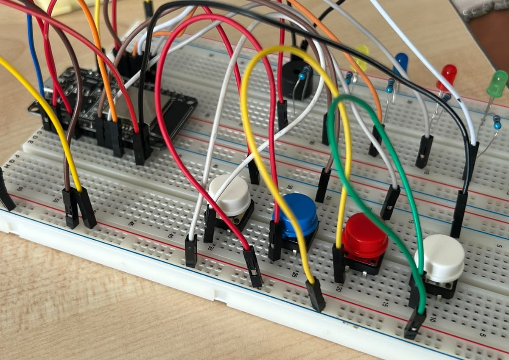
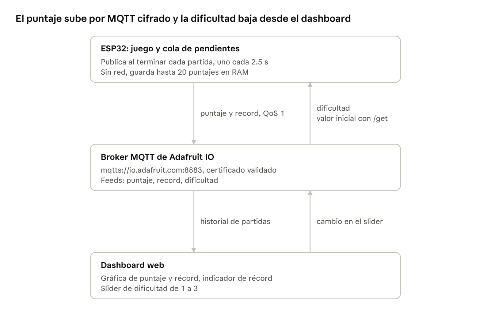
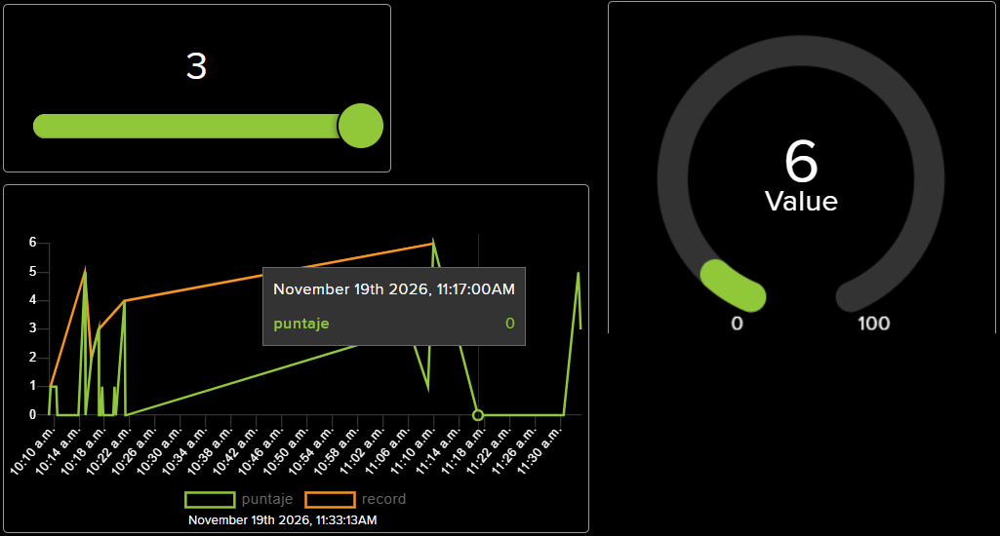
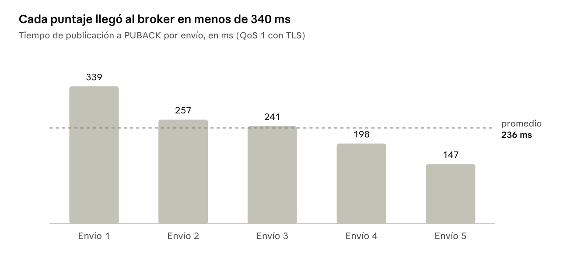
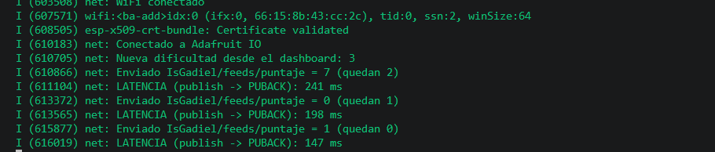

# Simón Dice IoT

Juego de Simón dice con **ESP32** que envía cada puntaje a **Adafruit IO** por **MQTT sobre TLS** y recibe la dificultad desde un dashboard web. Sigue funcionando sin internet y envía los puntajes pendientes al reconectar.

Proyecto final de *Internet de las Cosas* — UABC, FIAD, Ingeniería en Software y Tecnologías Emergentes.

| Integrante | Matrícula |
|---|---|
| Israel Gomez Ahumada | 373730 |
| Josue Gadiel Rodriguez Hernandez | 372927 |



## Arquitectura



| Feed | Dirección | Uso |
|---|---|---|
| `puntaje` | ESP32 → nube | Puntaje de cada partida (QoS 1) |
| `record` | ESP32 ↔ nube | Mejor puntaje; se lee al arrancar con `record/get` |
| `dificultad` | nube → ESP32 | Velocidad de la secuencia (1 a 3); se lee al arrancar con `dificultad/get` |

- Broker: `mqtts://io.adafruit.com:8883`, certificado validado con el bundle de ESP-IDF.
- Los envíos pasan por una cola en RAM (20 mensajes) y salen uno cada 2.5 s, para respetar el límite de 30 datos/min de la cuenta gratuita.

## Requisitos

- **ESP-IDF 6.1** (probado con v6.1.0). Desde ESP-IDF 6 el cliente MQTT no viene incluido: el proyecto lo declara en `main/idf_component.yml` (`espressif/mqtt`) y se descarga solo en la primera compilación.
- Una cuenta de Adafruit IO.
- Una red WiFi de **2.4 GHz** sin portal de inicio de sesión (por ejemplo, el punto de acceso de un celular).

## Compilar y cargar

1. Copia la plantilla de secretos y llénala con tus datos:
   ```
   cp main/config.example.h main/config.h
   ```
   `main/config.h` está en el `.gitignore`: nunca se sube al repositorio. Si falta, la compilación se detiene con un mensaje.
2. Compila, carga y abre el monitor (desde la terminal de ESP-IDF o con los botones de la extensión de VS Code):
   ```
   idf.py set-target esp32
   idf.py build
   idf.py -p COM5 flash monitor
   ```
   Cambia `COM5` por el puerto de tu ESP32. Si se queda en `Connecting....`, mantén presionado **BOOT**.

## Configurar Adafruit IO

1. En **Feeds → New Feed** crea `puntaje`, `record` y `dificultad` (en minúsculas).
2. En **Dashboards → New Dashboard** agrega:
   - *Line Chart* con `puntaje` y `record`.
   - *Gauge* con `record`.
   - *Slider* con `dificultad`: mínimo 1, máximo 3, paso 1.
3. Mueve el slider una vez para que el feed tenga un valor inicial.
4. Tu usuario y tu llave están en el ícono de **llave amarilla**.



## Hardware

Componentes del kit básico de ESP32: ESP32 DevKit, 3 LEDs (rojo, verde, amarillo), 1 LED RGB (solo el canal azul), 6 resistencias de 220 Ω, 4 botones, 1 buzzer **pasivo**, 2 protoboards y cables Dupont. La pantalla OLED es opcional: si no está, el juego funciona igual.

| Elemento | GPIO | Conexión |
|---|---|---|
| LED rojo / verde / azul / amarillo | 25 / 26 / 27 / 14 | GPIO → 220 Ω → ánodo; cátodo a GND |
| Botón rojo / verde / azul / amarillo | 23 / 19 / 18 / 4 | Una pata al GPIO, la diagonal a GND (pull-up interno) |
| Buzzer pasivo | 13 | GPIO → 2 × 220 Ω en paralelo → +; − a GND |
| OLED SDA / SCL (opcional) | 21 / 22 | I²C a 400 kHz, alimentada a 3.3 V |

Si tu LED RGB es de ánodo común, pon `LED_AZUL_ACTIVO_BAJO 1` en `main/pins.h`.

## Estructura del código

```
simon-dice-iot/
├── CMakeLists.txt
├── sdkconfig.defaults       tick de 1 ms, bundle de certificados TLS
├── dependencies.lock        versión fija del componente MQTT
├── docs/                    reporte, presentación e imágenes
└── main/
    ├── main.c               arranque: NVS, módulos y juego
    ├── game.c / game.h      secuencia, turnos, puntaje y dificultad
    ├── io.c / io.h          LEDs, tonos (LEDC) y botones con antirrebote
    ├── display.c / .h       driver SSD1306 por I²C
    ├── net.c / net.h        WiFi, MQTT, cola de pendientes y suscripciones
    ├── pins.h               mapa de pines
    ├── config.example.h     plantilla de secretos
    └── idf_component.yml    dependencia espressif/mqtt
```

## Resultados

Las cuatro pruebas del proyecto se cumplieron:

| Prueba | Resultado |
|---|---|
| Juego | La secuencia crece un color por ronda y detecta errores |
| Envío de datos | 31 puntajes registrados en el feed `puntaje` |
| Dificultad desde el dashboard | Valores 1, 2 y 3 recibidos y aplicados en la ronda siguiente |
| Sin conexión | 3 partidas jugadas sin red y enviadas al reconectar |

Latencia de publicación a PUBACK (QoS 1 con TLS): **promedio de 236 ms** en 5 envíos (147 a 339 ms).



El monitor serie imprime en cada envío `Enviado ... (quedan N)` y `LATENCIA (publish -> PUBACK): X ms`.



## Problemas comunes

- **No conecta al WiFi:** el ESP32 solo usa 2.4 GHz y no soporta redes con portal de inicio de sesión.
- **`Adafruit IO rechazo la conexion`:** usuario o llave mal escritos (el usuario distingue mayúsculas).
- **`Error de red MQTT`:** se perdió el internet; el ESP32 reintenta solo.
- **No encuentra la OLED:** revisa VCC/GND y SDA/SCL; el monitor escanea el bus I²C y dice qué encontró.
- **Un botón se "presiona solo":** usa dos patas en diagonal.
- **El buzzer suena igual en todos los colores:** es el activo; usa el pasivo.

## Documentación

- Reporte técnico: [`docs/IoT_RPF_Gomez_Rodriguez_373730_372927.pdf`](docs/IoT_RPF_Gomez_Rodriguez_373730_372927.pdf)
- Presentación: [`docs/IoT_PPF_Gomez_Rodriguez_373730_372927.pdf`](docs/IoT_PPF_Gomez_Rodriguez_373730_372927.pdf)
